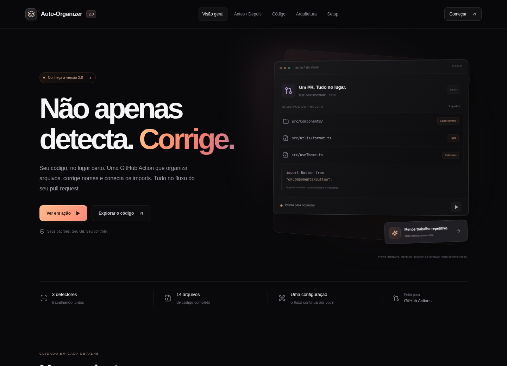

# Auto-Organizer v2.0

Projeto independente: documentação GitHub Action 



## Estrutura do repositório

| Caminho | Conteúdo |
| --- | --- |
| `src/` | App de documentação em React e TypeScript |
| `action/` | Manifesto, código, testes e bundle da GitHub Action |
| `tests/` | Testes da interface em desktop e celular |
| `.github/workflows/ci.yml` | Verificação automática de testes e builds |

O app e a Action são publicados juntos neste repositório. A referência de uso da
Action inclui o subdiretório: `SEU_USUARIO/auto-organizer/action@main` durante os
testes iniciais, ou uma tag validada como `@v2` após sua criação.

## Desenvolvimento

Node.js 24 e npm. Na raiz deste projeto:

```sh
npm ci
npm run dev
```

O servidor de desenvolvimento usa a porta 8090. Não há backend nem credenciais
necessárias para visualizar a documentação. Os botões de cópia usam o clipboard
do navegador; downloads de arquivos são gerados localmente.

## Conteúdo

- Visão geral com uma simulação local da organização de um PR.
- Quatro comparações antes/depois e exemplo de relatório.
- Explorador dos 14 arquivos reais em `action/`, com busca, filtros, cópia e download.
- Diagrama interativo dos seis módulos e permissões.
- Setup com repositório e modo configuráveis no workflow.

Os textos exibidos na aba Código vêm dos arquivos reais via imports `?raw` do
Vite. Alterar um módulo da Action atualiza automaticamente a documentação.

## Validação

```sh
npm run build
npm test
npm run test:e2e
npm run build:action
```

O build inclui verificação TypeScript. Os testes da Action criam repositórios Git
temporários e um remoto local descartável; não fazem pushes para o GitHub. Os testes
Playwright cobrem desktop e celular e iniciam um Vite próprio na porta 4175.
O runner usa `/usr/bin/chromium` quando disponível; para outro binário, configure
`PLAYWRIGHT_CHROMIUM_EXECUTABLE_PATH`. Em uma máquina sem Chromium, use
`npx playwright install chromium`.

## Publicação

Para hospedar apenas a documentação, publique `dist/` após `npm run build`.
A navegação usa fragmentos de URL e não exige regras especiais para rotas SPA.

A GitHub Action tem seu bundle em `action/dist/`, incluído no versionamento.
Consulte [o guia da Action](action/README.md) para atualizar esse bundle, configurar
o workflow e validar num PR real. A criação do repositório não publica o site nem
cria a tag `v2`. O exemplo de workflow usa um proprietário substituível e o modo
`report` por padrão.

A CI executa os testes locais da Action, os testes de interface e os dois builds
em pushes e pull requests. Ela não aplica correções nem faz commits automáticos.

## Acessibilidade

Abas com navegação por teclado, link para pular ao conteúdo, estados de foco,
feedback de cópia e respeito a `prefers-reduced-motion`. A demonstração da página
inicial é ilustrativa e não acessa repositórios.

## Licença

MIT. Consulte [LICENSE](LICENSE) e as licenças de dependências em
`action/dist/licenses.txt`.
